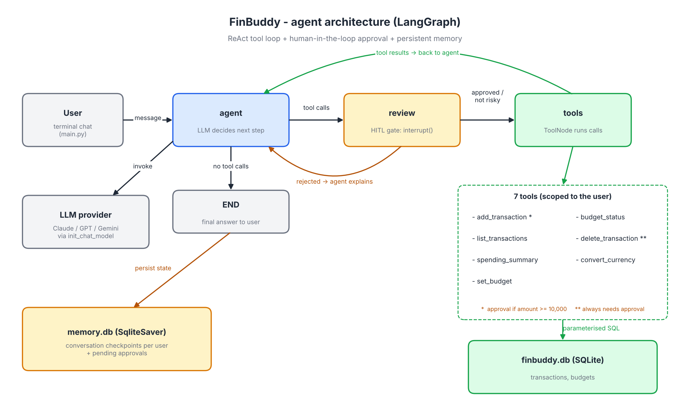

# FinBuddy - Agentic Personal-Finance Assistant

An AI agent (LangGraph) that you talk to in plain English to track spending, check budgets
and answer questions about your money. It decides on its own which tools to call, loops until
it has the answer, and **pauses for human approval before risky actions**.



## Why it is an *agent* (not just a chatbot)

| Agentic property | How FinBuddy does it |
|---|---|
| Autonomous decisions | The LLM chooses which of 7 tools to call, in what order, and when to stop |
| Multi-step reasoning | ReAct loop: `agent -> tools -> agent -> ...` (e.g. add expense, then check the budget, then warn) |
| Tool use | Real actions on a SQLite database: add, list, summarise, budget, delete, convert currency |
| Human-in-the-loop | LangGraph `interrupt()` pauses before deletes and large transactions (>= 10,000) |
| Memory | `SqliteSaver` checkpointer remembers the conversation across restarts; SQLite holds the data |
| Guardrails | Per-user data isolation, parameterised SQL, input validation, "do not retry rejected actions" |

## Setup

Requires Python 3.10+ and an LLM API key (free Gemini key or Anthropic).

```bash
git clone <your-repo-url>
cd finbuddy
python -m venv .venv
source .venv/bin/activate          # Windows: .venv\Scripts\activate
pip install -r requirements.txt

cp .env.example .env               # Windows: copy .env.example .env
# open .env and paste your key. Free option: Gemini key from https://aistudio.google.com/apikey
# (default in .env.example). Paid option: ANTHROPIC_API_KEY for Claude.
```

## Run

```bash
python seed_demo_data.py --user me   # optional: 3 months of demo data + budgets
python main.py --user me             # start chatting
```

Example session:

```
you > I spent 450 on lunch today
finbuddy > Logged 450 INR for food. Your food budget is 34% used this month.

you > how much did I spend on entertainment last month?
you > set a budget of 4000 for transport
you > which category am I overspending in?
you > I bought a laptop for 55000
  APPROVAL NEEDED
   - add_transaction({'amount': 55000, 'category': 'shopping', ...})
     reason: Large transaction (55000 INR >= 10000).
   Approve? [y/N]: y
you > delete transaction 12
you > convert 5000 INR to USD
```

Options: `--user NAME` (separate data and memory per user), `--model openai:gpt-4o-mini`
(any LangChain provider), `--auto-approve` (skip approval prompts).

## Run the tests (no API key needed)

```bash
python -m unittest discover -s tests -v
```

A scripted fake LLM drives the real graph, so the tests check the tool loop, the approval
gate (approve and reject paths), user isolation and input validation.

## Project structure

```
finbuddy/
  main.py              CLI chat loop, handles approval prompts, SQLite checkpointer
  seed_demo_data.py    demo transactions and budgets
  make_diagram.py      regenerates docs/architecture.png
  finbuddy/
    graph.py           LangGraph: agent -> review (HITL) -> tools loop
    tools.py           the 7 tools + approval rules
    db.py              SQLite schema (transactions, budgets)
    llm.py             provider-agnostic model factory
  tests/test_agent.py  offline tests
  docs/architecture.png
```

## Database schema

```sql
transactions(id, user_id, date, kind['expense'|'income'], amount, category, description, created_at)
budgets(user_id, category, monthly_limit)           -- PRIMARY KEY (user_id, category)
```

Conversation checkpoints are stored by LangGraph's `SqliteSaver` in `memory.db`.

## Limitations

- Currency conversion uses fixed approximate rates (demo only).
- Provides budgeting information, not professional financial advice.
- Terminal interface only; the agent logic in `graph.py` can be reused behind a web UI.
